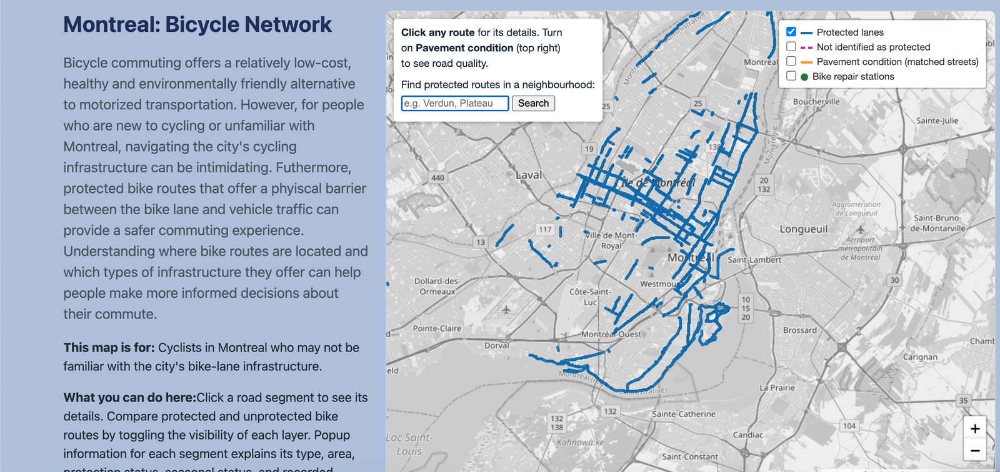
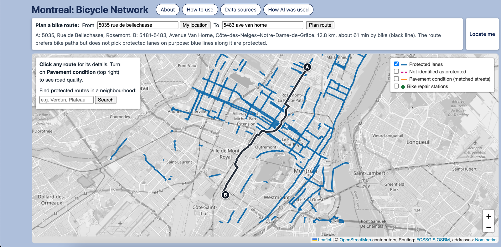

# Montreal Bike Lanes

[Link to the site](https://destinbb.github.io/GEOG464/site/)

## The five sentences

1. **Problem:** People commuting by bike in Montréal may not know what cycling infrastructure is available across the city, making it harder to understand the potential route options.
2. **Audience:** This map is for cyclists in Montreal who want to explore the city's bicycle network by area and facility type.
3. **Core action:** Toggle the protected and not-identified as protected layers, then click a segment to inspect its type, area, protection status, year-round status, and recorded length. Locate yourself on the map or plan a route from A to B
4. **Boundary:** 
5. **Data:** The map uses Montreal Open Data's continuously updated "Réseau cyclable" GeoJSON, read and narrowed in the project notebook to records on the island of Montreal with usable line geometry and required descriptive fields. :https://www.donneesquebec.ca/recherche/dataset/vmtl-pistes-cyclables/resource/0dc6612a-be66-406b-b2d9-59c9e1c65ebf. City of Montréal, licensed under CC BY 4.0, accessed October 1, 2026. The notebook rounds coordinates to 5 decimal places (about 1 m) and writes compact JSON, which brought the cleaned file from 5.44 MB to 3.60 MB (under the 5 MB guide) and the pavement file from 3.43 MB to 2.58 MB, so the map loads faster on a phone. Rounding did not change the feature counts. Since widening the data to every route on the island of Montreal, the cleaned file has 9,483 bike segments (4.19 MB) and the pavement file has 5,248 (2.58 MB).
6. ## A3 data: 
The pavement layer uses ([Indicateurs de condition des chaussées du réseau routier]), published by the City of Montréal ([https://donnees.montreal.ca/dataset/condition-chaussees-reseau-routier#additional-info]), licensed under Creative Commons Attribution 4.0 International. Accessed October 23, 2026. I joined the pavement PCI condition category, score and survey date to bike-network GeoJSON using ID_TRC, and only included matched records in the pavement overlay (5,248 street segments). These ratings describe surveyed street segments but may not represent the bike-lane surface itself.

## Bike repair stations data:
The repair stations layer uses bicycle repair station points from OpenStreetMap (https://www.openstreetmap.org), © OpenStreetMap contributors, licensed under the Open Database License (ODbL) (https://www.openstreetmap.org/copyright). Downloaded with Overpass Turbo (https://overpass-turbo.eu) using the query `node["amenity"="bicycle_repair_station"]` within the City of Montréal boundary (`admin_level=8`), and exported as GeoJSON to `data/repair_stations.geojson`. Accessed November 2, 2026. The file has 87 stations. I did not edit the data; the map shows each station's air pump, tools, opening hours and operator, and shows "not recorded" when a station has no value (only 27 of 87 list opening hours). OpenStreetMap is mapped by volunteers, so some stations may be missing, moved or out of service.

## AFTER Demo
At my demo I felt like my site description could have been a bit more descriptive into what you can actually do with the website. 
After adding my second data layer, I feel like I really have to work on the core action of my website and add more usability features so a real user could actually plan a route based on their preferred parameters.  
## My neighbours 5 second answers: 
"This map is about the Montreal bicycle network. It maps different bike lanes based on whether they are physically protected from cars or not. It always maps the pavement condition of each route based on its Pavement Condition Index or PCI. Blue represents the network's protected routes while dark red represents the network's unprotected routes. For the pavement layer, the darkest colours represent the poorest pavement condition while the lightest represent the best" --- Thanks Lukas

## Run the MVP

1. Open the `GEOG464` folder in VS Code.
2. Open `notebooks/TermProject.ipynb` and run every cell from top to bottom. It reads the raw GeoJSON, reports exclusions, rounds coordinates to 5 decimals, writes `bike_lanes_clean_english.geojson`, and finishes with count, geometry-extent, geometry-type, property and file-size (under 5 MB) checks.
3. Right-click `site/index.html` and choose **Open with Live Server**. The page fetches the notebook output from `../data/bike_lanes_clean_english.geojson`
4. Use the map layer checkboxes to show or hide protected lanes. Click a line for its attributes.

## How AI was used - green lane
How AI was used
I used GitHub Copilot with gpt-6-luna to help load and clean GeoJSON data from Données Québec's open-data portal. I filtered the data to include only features where VILLE_MTL = Oui, removed features with missing geometry or required fields, counted exclusions, and translated selected property keys from French to English. I also used the agent to separate protected and unprotected bike routes. I reviewed the filtered data to verify that routes were within Montréal, the translations preserved the original meaning, and segments were correctly classified.

### Later AI use (since October 30th) blue lane
I later used Claude Code (Claude Opus 5.5) to widen the data filter from VILLE_MTL = Oui to every route on the island of Montreal, including the linked municipalities such as Westmount and Dorval, and to update the notebook's checks and counts.

After usability testing showed that readers struggled to find themselves on the map and had no way to plan a trip, I used Claude Code to add a "Locate me" button (using the browser's location) and an A-to-B route planner that looks up addresses with Nominatim and gets a bike route from the FOSSGIS OSRM server, both using OpenStreetMap data. Claude Code tested both features in a headless browser at computer and phone width, and checked that the existing layers and neighbourhood search still worked.

### A3 AI disclosure (process)
Blue Lane

**Tool and model:**  Claude Opus 5.5 

**What I asked:** 
1) I asked Claude to join the pavement CSV to the bike lanes by their shared ID_TRC and translate all French names to English
2) I asked Claude to add popups for each segment that show the road's quality and PCI rating and a layer toggle that allows the layer to be turned on and off
3) I asked Claude to make the neighbourhood search report pavement condition for the borough's protected lanes, using tests 4–6 as the target

**What came back:**
1) Claude returned a new "bike_lanes_with_pavement.geojson" file 
2) Claude added popup windows to the pavement layer and added a layer toggle to the legend box
3) Claude added code to count borough's protected segments with a pavement record and the share in good or excellent condition. It leaves segments with no record out of the count instead of treating them as bad, and says "None have a pavement survey record" when there are none. It also made bike lane lines thicker on hover.

**What I kept or changed, and why:** 
I kept missing pavement data out of the score so readers don't mistake it for poor roads and the % rating  describing the street, not the bike-lane surface. 
Changed McGill location to downtown, as prior searches brought you to the West Island location 

**How my tests checked it:** I wrote tests 1–3 before any code (commit "A3 card and three tests, before any code", October 30), and tests 4–6 before the search-summary code (November 7; that commit was co-authored with Claude Code). Test 3, the edge case, checks that a route with no pavement match stays blue with its normal popup and no PCI score. Tests 4–6 check exact numbers for Verdun (277 / 167 / 69, 41%), Ville-Marie (263 / 226 / 61, 27%) and Pierrefonds-Roxboro (17 / 9 / 0, 0%). The Pierrefonds test checks that the page reports 0 out of 9 surveyed rather than "no data". 

**What stayed mine:**
I chose the pavement dataset and the ID_TRC join, the A3 card, the edge case and the decision that missing data is never shown as a score, test 3's example (Île-des-Sœurs), and checking each result on the map. I also decied to add a locate me feature and A to B route planning. I decided to restructure the page layout to show less information and put the locate me and A to B planning at the top of the site. 

# A3 feature: Pavement Condition Index
For A3 I added the Pavement Condition Index so my reader can see the road condition of each potential bike route. 
It has depth because it displays the pavement condition of specific roads in Montreal. 
I will know it works when: I can turn on the pavement layer switcher and examine each road segment based on its PCI rating. 
My edge case is a bicycle route segment with no matching pavement condition record. Since the bicycle network and pavement condition datasets are separate sources joined using ID_TRC, not every bicycle route necessarily has corresponding pavement information. The bicycle route should remain visible on the map with its normal popup, and no pavement line should be drawn for it. Missing data is never shown as a score, so readers won't mistake it for poor road conditions.

# Tests
Test 1: turn on the layer switcher for PCI in the legend
-Expected: PCI layer loads and displays the road's pavement condition rating 
Test 2: Click a segment of road to view its pavement condition
-Expected: the pop-up opens and displays the segment's PCI score and rating 
Test 3: A bike route with no pavement match. With the pavement layer on, I zoom in and find any protected route that still displays as blue. It has no record in the pavement survey, either because its ID_TRC is 0 (189 protected routes) or because its ID_TRC is not in the survey (484 protected routes). Example: the dedicated path at the south tip of Île-des-Sœurs, Verdun, which has ID_TRC 0.
-Expected: the path stays blue with no pavement colour over it, the normal popup opens with no PCI score, and no errors come from app.js
-Result: PCI layer is not displayed over Île-des-Sœurs route, but popup still displays route information

## A3 feature, part 2: pavement summary in the neighbourhood search
Test 4: I search "Verdun".
-Expected: the map zooms to Verdun and the box says "277 protected segments in Verdun. 167 have a pavement survey record; 69 of those (41%) are in good or excellent condition."
Test 5: I search "ville marie".
-Expected: "263 protected segments in Ville-Marie. 226 have a pavement survey record; 61 of those (27%) are in good or excellent condition."
Test 6: A neighbourhood where no surveyed segment is in good condition. I search "Pierrefonds".
-Expected: "17 protected segments in Pierrefonds-Roxboro. 9 have a pavement survey record; 0 of those (0%) are in good or excellent condition." The page says 0 out of 9 surveyed, not "no data", and there are no console errors.

## A3 feature: how the code works

Line numbers are for `site/app.js` and the notebook as of November 13, 2026.

| Lines | What they do |
| --- | --- |
| Notebook cells 13–18 (`notebooks/TermProject.ipynb`) | Joins the pavement CSV to the bike lanes by ID_TRC and writes `bike_lanes_with_pavement.geojson`. Joins the 2 data layers by their shared ID_TRC |
| [site/app.js:269-286](site/app.js#L269-L286) | Pavement colours, English names for the French condition categories, and `colourForPavement`. Translates French condition category names to English and assigns a colour to each of the 5 levels of pavement conditions |
| [site/app.js:372-388](site/app.js#L372-L388) | The pavement layer: line colour from the condition, and the popup with PCI score and survey date. Popups show condition of the surveyed pavement and give PCI score, with 0 being the worst and 100 being the best |
| [site/app.js:429-459](site/app.js#L429-L459) | The pavement legend, shown only while the pavement layer is on. Only displays the pavement layer when the toggle is turned on
| [site/app.js:533-551](site/app.js#L533-L551) | The pavement summary in the neighbourhood search. Gives a summary of the total number of streets surveyed in the neighbourhood and gives the % of streets that have a good or excellent condition 

**One thing I do not yet fully understand:** how I can display the Pavement data alongside the protected routes without the 2 covering each other 

 ## Pre-flight report (Lab 7)
| Check | Result | What I did |
| --- | --- | --- |
| 1. Cold start | fault:console showed "favicon.ico Failed to load resource: 404" on a fresh private-window load; the map and data loaded fine| fixed in commit "Add bike icon to favicon to stop 404 in console"|
| 2. Read every label| Pass| |
| 3. Ask twice |Fault:typing "l" said "2088 protected segments in Ahuntsic-Cartierville" (that borough has 311); "la" said "887 in Saint-Laurent" (it has 30); "le" said "1433 in Ahuntsic-Cartierville". The map zoomed out to several boroughs at once. A partial name matches many boroughs, but the message names only the first. | fixed in commit: Search lists matching boroughs instead of a mixed count: when a search matches more than one borough, the box lists them and asks the reader to type more, and the map doesn't move. Retested: "la" lists 6 boroughs; "Verdun" says 277|
| 4. The edge | Fault:(a) an empty search said "No protected routes found for ". (b) Only the exact hyphenated spelling "Montreal-nord" worked: "montreal nord" and "plateau mont royal" said "No protected routes found", although those boroughs have 40 and 201. |fixed in commit "Search ignores hyphens, spaces and apostrophes": "montreal nord", "plateau mont royal" and "cote des neiges" now find their boroughs. Retested on the live site.
| 5. The data does not come | Fault: with bike_lanes_clean_english.geojson blocked, the map showed with no data and no message nearby. The only message was in the status line at the bottom of the text column, and it told the reader to "Open the console (F12)". The search box was still there, and pressing Search reloaded the page. | fixed in commit by adding catch: "Show data-load error on the map and hide search": a plain-language message now appears on the map and the search box is hidden. Retested by blocking the file again.|
| 6. On a phone (size view and my phone) |Fault: Major further mobile optimization to be done | |
| 7. Mouse in my pocket | Pass| |
| 8. Accessibility audit |Pass: Lighthouse Accessibility 100 on the live site; no red or orange items. | |

## Part 3: what I found, and one fix

**Evidence:** In both rounds 1 and 2, the testers tried to find routes by searching by neighbourhood. When no routes were returned, the testers said that it would be much easier if they could locate themselves on the map and search by location.

**Severity:** 3, each time the tester tried to identify routes by typing in their neighbourhood, the search returned "No protected routes found" which stopped them from completing the task. Testers had to manually zoom into the neighbourhoods to find routes. 

**My change:** Added a search by Location and locate me option to the search bar, which allows users to input a specific address or locate themselves on the map

**Recheck:** Asked Andre to type in a location for A and a location for B the search returned:  "5035, Rue de Bellechasse, Rosemont. B: 5481-5483, Avenue Van Horne, Côte-des-Neiges–Notre-Dame-de-Grâce. 12.8 km, about 61 min by bike (black line). The route prefers bike paths but does not pick protected lanes on purpose: blue lines along it are protected". The site also showed the route in a black line with A and B as pins on the map

**Before:**

**After:**

## What my map remembers 
The map remembers where the reader left place and zoom, the repair stations save to "My repair stations", and the points readers can add to report problems and ideas. 
A cyclist planning routes over several visits can come back to the same routes, area and saved stations without searching again, and shared reports let cyclists warn
each other about construction or problems on a route.

***Where it is kept***
- The map view and saved repair stations are personal: they are stored in the readers own brower(localstorage), in their respective device. Nobody else sees them. 
-Added points are shared: they are stored in my Firebase database (northamerica-northeast1 (Montréal)) and every reader sees them. Each point keeps only its location, catergoty, note up to 80 characters an anonymous browser id and a time. No names. I will delete the database on 31 December 2026, after the course.

**How to clear it**
- Map view: press *Reset view* at the top left of the map.
- A saved station: open its popup and press **Saved (remove)**.
- A point they added: open it and press delete (readers can only delete their own points).
- Everything personal at once: clear this site's data in their browser settings. 

**Which file does the work:** `remember.js` saves the view and the saved stations; `memory.js`
saves the shared points to Firebase. 

**One thing I understand** localstorage is kept per website so destinbb.github.io and Live Server have a seperate saved list

## A4 feature: routes scored with my data

### Tests (written before the code)
| # | What I do | Expected | Result |
| --- | --- | --- | --- |
| 1 | A longer trip: Oratoire Saint-Joseph → Marché Jean-Talon | Two routes drawn: one solid, one grey dashed. Two buttons with scores; labels "fastest" and "most protected" (one route can have both). The map starts on the most protected. Clicking the other button switches the solid line. | |
| 2 | A short trip: Hall Building → Parc La Fontaine | One route with its scores, no labels, and "The router found only one route for this trip." | |
| 3 | Edge: a trip on streets with no protected lanes | "0% on protected lanes", no error in the console. | |
| 4 | Add a "Something is wrong" point right on route 1's line, note "test construction". Plan the trip again. | The warning lists "test construction". | |
| 5 | Edge: add a point about 300 m from the route. Plan again. | Not listed. | |
| 6 | Edge: a point with the note `<b>hi</b>` on the route | Shown as the plain text `<b>hi</b>`, not in bold, so readers' notes can't add HTML. | |
| 7 | Edge: DevTools → Network → "Slow 3G", reload, and plan a route straight away | The route shows with "not scored yet", and no error. | |